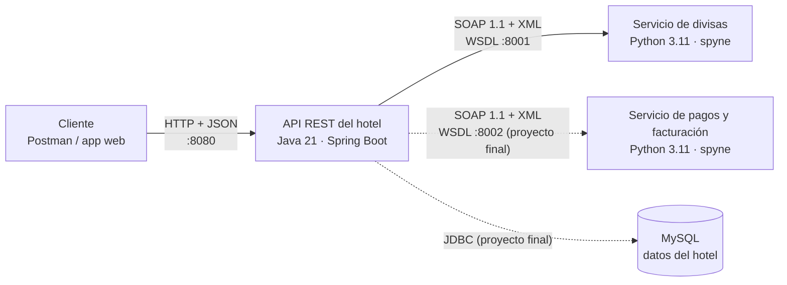

# Hotel Colibrí · Diseño preliminar de la arquitectura (Parte A)

> Actividad preliminar del proyecto final de Arquitectura Orientada a Servicios.
> Este documento es el borrador que crecerá hasta el `arquitectura_y_diseno.pdf` del Avance 1.

## 1. Descripción del sistema

El Hotel Colibrí tiene dos sistemas que **no se pueden reescribir** y que se ofrecen como servicios web SOAP
(divisas y pagos). La nueva plataforma de reservas es una **API REST** que funciona como *fachada*: el cliente
solo habla con ella, y ella llama a los servicios SOAP cuando los necesita.

En la prueba piloto solo se construyen el servicio de **divisas** y una API mínima que lo consume. La API todavía no usa base de datos.

## 2. Diagrama de arquitectura



Versión en texto, por si el visor no muestra Mermaid:

```
                 HTTP + JSON                       SOAP + XML (WSDL)
 [Cliente] ──────────────────▶ [API REST :8080] ──────────────────▶ [Divisas :8001]   ← piloto
 Postman / app web             Spring Boot          ┆                 Python · spyne
                                                    ┆ SOAP + XML
                                                    ├┄┄┄┄┄┄┄┄┄┄┄┄┄┄┄▶ [Pagos :8002]     ← proyecto final
                                                    ┆ JDBC
                                                    └┄┄┄┄┄┄┄┄┄┄┄┄┄┄┄▶ [MySQL]           ← proyecto final
```

Cada servicio corre en **su propio proceso y puerto**. Si se apaga uno, los demás siguen funcionando, y la API responde
`503` en lugar de caerse. A esto se le llama **autonomía**.

## 3. Inventario de servicios

| Servicio | Tipo | Lo ofrece (proveedor) | Lo consume | Responsabilidad | Operaciones / recursos | Contrato |
|---|---|---|---|---|---|---|
| **Divisas** | SOAP 1.1 | `soap/divisas_service.py` · puerto 8001 | API REST | Convertir importes entre MXN y otras monedas | `listarMonedas`, `convertir`, `obtenerTipoCambio` | `http://localhost:8001/?wsdl` |
| **Pagos y facturación** *(proyecto final)* | SOAP 1.1 | `soap/pagos_service.py` · puerto 8002 | API REST | Cobrar con token, reembolsar y facturar | `autorizarPago`, `consultarPago`, `reembolsarPago`, `emitirFactura` | `http://localhost:8002/?wsdl` |
| **API REST del hotel** | REST | `api/` (Spring Boot) · puerto 8080 | Cliente (Postman, app web) | Gestionar habitaciones, huéspedes y reservas, y componer divisas + pagos | Ver sección 5 | OpenAPI (springdoc) |

**Proveedor:** el que ofrece el servicio y publica su contrato. **Consumidor:** el que lo usa leyendo ese contrato.
La API REST tiene los dos papeles: **consume** los servicios SOAP y **provee** recursos REST al cliente.

## 4. Contrato del servicio de divisas

| Elemento | Valor |
|---|---|
| Aplicación / clase | `Divisas` / `DivisasService` |
| Espacio de nombres | `http://hotelcolibri.mx/divisas` |
| Dirección | `http://localhost:8001/` · WSDL en `http://localhost:8001/?wsdl` |
| Protocolo | SOAP 1.1 con validación lxml |

| Operación | Entradas (obligatorias) | Salida | Faults |
|---|---|---|---|
| `listarMonedas` | — | `Array(Unicode)` → MXN, USD, EUR, CAD | — |
| `convertir` | `monto` xs:decimal, `origen` xs:string, `destino` xs:string | xs:decimal, 2 decimales | `Client.MonedaNoSoportada`, `Client.MontoInvalido` |
| `obtenerTipoCambio` | `origen`, `destino` xs:string | xs:decimal, 6 decimales | `Client.MonedaNoSoportada` |

Regla: `monto × tasa(origen) ÷ tasa(destino)` con redondeo **medio hacia arriba**. Tasas en MXN por unidad:
MXN 1.00 · USD 18.00 · EUR 21.00 · CAD 13.00.

Si falta un parámetro, la validación lxml responde `Client.SchemaValidationError` antes de ejecutar la operación.

## 5. Recursos de la API REST

### 5.1 Piloto (actividad preliminar, sin base de datos)

| Método | URI | Respuesta | Códigos |
|---|---|---|---|
| GET | `/api/v1/divisas` | Lista de monedas | 200 · 503 si Divisas está apagado |
| GET | `/api/v1/cotizaciones?monto=5400&origen=MXN&destino=USD` | Monto convertido y moneda | 200 · 400 moneda o monto inválido · 503 |

### 5.2 Propuesta para el proyecto final

Las rutas usan **sustantivos** (recursos) y el método HTTP indica la acción. Las acciones del ciclo de vida se modelan
como sub-recursos que se crean con `POST`.

| # | Capacidad | Método y URI | Éxito |
|---|---|---|---|
| 1 | Alta / consulta / modificación de habitaciones | `POST`, `GET /api/v1/habitaciones` · `GET`, `PUT /api/v1/habitaciones/{numero}` | 201 / 200 |
| 1 | Desactivar habitación (no se borra) | `PATCH /api/v1/habitaciones/{numero}` con `{"activa": false}` | 200 |
| 2 | Habitaciones disponibles | `GET /api/v1/habitaciones?entrada=2027-01-15&salida=2027-01-18&huespedes=2` | 200 |
| 3 | Huéspedes (opcional) | `POST`, `GET /api/v1/huespedes` · `GET`, `PUT /api/v1/huespedes/{id}` | 201 / 200 |
| 4 | Crear y consultar reserva | `POST /api/v1/reservas` (+ cabecera `Location`) · `GET /api/v1/reservas/{id}` | 201 / 200 |
| 5 | Listar reservas con filtro | `GET /api/v1/reservas?estado=PENDIENTE&huesped=3` | 200 |
| 6 | Monedas disponibles *(fija)* | `GET /api/v1/divisas` | 200 |
| 7 | Cotizar reserva *(fija)* | `GET /api/v1/reservas/{id}/cotizacion?moneda=USD` | 200 |
| 8 | Pagar | `POST /api/v1/reservas/{id}/pago` con `{"moneda":"USD","tokenTarjeta":"tok_aprobada"}` | 200 |
| 9 | Facturar | `POST /api/v1/reservas/{id}/factura` con `{"rfc":"XAXX010101000","razonSocial":"..."}` | 201 |
| 10 | Cancelar / llegada / salida | `POST /api/v1/reservas/{id}/cancelacion` · `/llegada` · `/salida` | 200 |

## 6. Decisiones del piloto

| Decisión | Por qué | Alternativa descartada |
|---|---|---|
| `Decimal` en Python y `BigDecimal` en Java para dinero | `float` no representa exacto 0.1 ni 257.14; con float el resultado puede salir 257.13 | `float` / `double` |
| Redondeo `ROUND_HALF_UP` | Es el redondeo «medio hacia arriba» que pide el contrato | El redondeo por defecto de Python (`ROUND_HALF_EVEN`) |
| Errores como `Fault` con código `Client.*` | El código viaja en el XML y la API lo puede traducir a HTTP (400, 422…) | `ValueError`: spyne lo oculta como "Internal Error" |
| Agregar `obtenerTipoCambio` desde ahora | El proyecto final la exige; así el WSDL no cambia después | Agregarla en el proyecto final |
| Cliente Java generado con **wsimport** | La rúbrica del proyecto final lo pide (criterio 5) | `jaxb-maven-plugin` + Spring WS (lo usamos en prácticas anteriores) |
| Estructura de carpetas del repositorio final | Evita reorganizar después | Un proyecto suelto por actividad |
